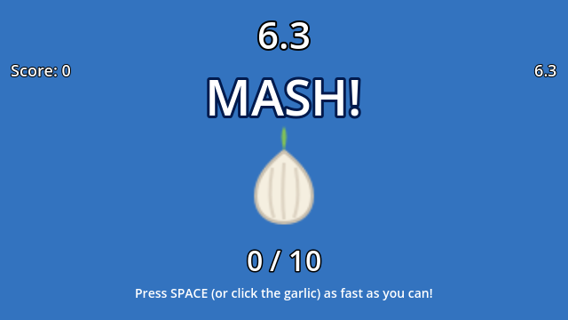
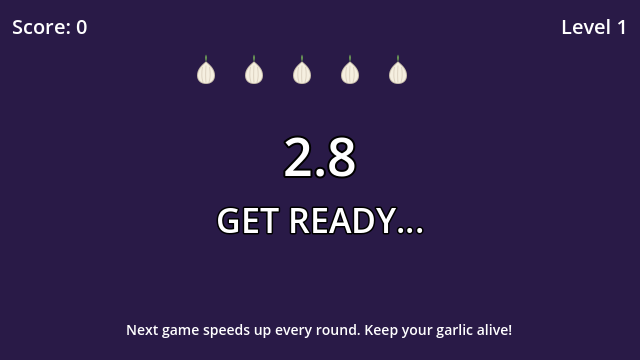

# Garlic Panic!

Garlic Panic! is a fast-paced WarioWare-style kitchen microgame collection I built with Godot 4.7 and HTML5 Canvas. You play as a 5-clove garlic bulb trying to survive 12 rounds of kitchen hazards while the game speed increases after every round you beat.


* **Play in Your Browser:** [https://aariv.me/garlic-panic/](https://aariv.me/garlic-panic/)
* **Source Repository:** [https://github.com/draarivpatel-ui/garlic-panic](https://github.com/draarivpatel-ui/garlic-panic)

## Screenshots

| Intermission (`timer_screen.tscn`) | 1. `DODGE!` (`minigame_1.tscn`) |
| :---: | :---: |
|  |  |

| 2. `MASH!` (`minigame_2.tscn`) | 3. `CATCH!` (`minigame_3.tscn`) |
| :---: | :---: |
|  |  |

## Why I Built This

For the Stardance WarioWare mission, I wanted to capture the chaotic feel of classic *WarioWare, Inc.* where a single one-word prompt (`DODGE!`, `MASH!`, `CATCH!`, `TIMING!`, `SLICE!`, `SORT!`) flashes on screen and you only have a few seconds to figure out what your hands need to do.

Since Wario's favorite food is garlic, I made the player a five-clove garlic bulb (`lives = 5`) trying to survive 12 kitchen rounds. Every time you clear a microgame, `Global.speed_multiplier` goes up by `+0.15x` (from `1.00x` up to `2.50x`), which speeds up all the moving objects and shortens the round timer (`clamp(7.0 / speed_multiplier, 3.0, 8.0)` seconds).

## The 6 Microgames

1. **DODGE! (`scenes/minigame_1.tscn`):** Red spikes fall from the ceiling at `(170..260) * speed_multiplier` px/s. Move left and right with Arrow keys, `A` / `D`, or your mouse until the timer hits `0.0s`.
2. **MASH! (`scenes/minigame_2.tscn`):** Rapidly press `SPACE` or click the center garlic bulb to hit the target press count (`ceil(10 * speed_multiplier)`) before time runs out.
3. **CATCH! (`scenes/minigame_3.tscn`):** Move the kitchen paddle left and right to catch a falling star dropping at `200 * speed_multiplier` px/s before it hits the floor.
4. **TIMING! (`scenes/minigame_4.tscn`):** A marker sweeps back and forth across a bar at `380 * speed_multiplier` px/s. Press `SPACE` or click `LOCK IN!` while the marker is inside the central green zone (`x = 270..370`).
5. **SLICE! (`scenes/minigame_5.tscn`):** A red tomato and a friendly garlic bulb slide across a cutting board under a cleaver. Press `SPACE` or click `CHOP!` when the tomato is inside the green chop zone and the garlic is safely outside it.
6. **SORT! (`scenes/minigame_6.tscn`):** Kitchen items pop into the center sorting chute one by one. Press `Left` (`A` / Left Arrow) for the Garlic Bin or `Right` (`D` / Right Arrow) for the Tomato Bin to sort 4 items before time runs out.

## How to Play or Run Locally

### Play in the Browser
Open [https://aariv.me/garlic-panic/](https://aariv.me/garlic-panic/) (or open `index.html` locally). Because Godot 4 WebAssembly exports create large `.wasm` and `.pck` bundles with `SharedArrayBuffer` header requirements on static hosts, I also wrote `index.html` as a 60fps HTML5 Canvas + Web Audio port that mirrors the exact 640x360 coordinates, SVG sprites, and `Global` state machine of my GDScript files. You can play the full 12-round campaign or click any of the 6 microgames on the title screen to practice it directly.

### Open in Godot 4
1. Install [Godot 4.x](https://godotengine.org/download).
2. Open the Godot Project Manager, click **Import**, and select `project.godot` in this folder.
3. Press **F5** to run `scenes/title_screen.tscn`.

You can also run the headless smoke test from the terminal:

```sh
Godot --headless --path . res://tests/smoke_test.tscn
```

## License

MIT License. See [LICENSE](LICENSE).
