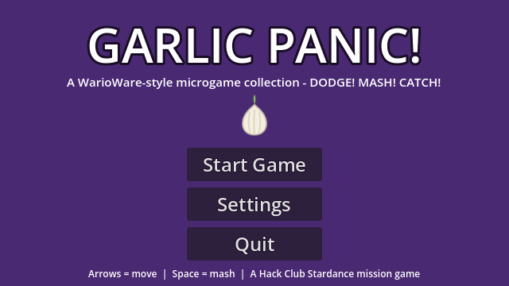
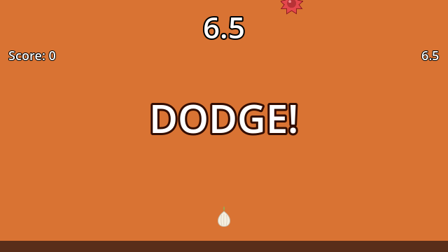

# Garlic Panic! - a WarioWare-style microgame collection





A Hack Club **Stardance "Make a WarioWare Game"** mission submission for **Aariv Patel**.
Built with **Godot 4.7** (GDScript), following the mission's 17-step guide.

Three frantic microgames chain together WarioWare-style - each one flashes its
instruction, lasts a few seconds, and the whole game speeds up every round.

## The microgames

| # | Name | Command | Win condition |
|---|------|---------|---------------|
| 1 | **DODGE!** | ← / → (or A/D) to move | Survive the timer without touching a falling spike |
| 2 | **MASH!** | Mash SPACE (or click the garlic) | Hit the mash quota before the timer |
| 3 | **CATCH!** | ← / → to move the paddle | Catch the falling star before it hits the floor |

## The WarioWare glue

- **Title screen** - Start Game / Settings (fullscreen toggle) / Quit.
- **Intermission** (`timer_screen`) - shows your 5 garlic lives, level number,
  score, and a countdown before each microgame.
- **Speed multiplier** - every win raises a global speed multiplier (up to 2.5x):
  obstacles fall faster, the mash quota grows, and each microgame's timer shrinks.
- **Score** - +1 per completed microgame, shown in the HUD and intermission.
- **Fail** - lose one garlic; the microgame replays. Out of garlic → **GAME OVER**
  screen with Retry. Survive all 9 rounds → **YOU WIN!** screen with Play Again.

## Controls

- **Arrow keys / A-D** - move (Dodge, Catch)
- **Space** - mash (Mash); mouse click also works on the garlic button

## How to run it

1. Download **Godot 4.x** (standard build, not .NET) from
   [godotengine.org/download](https://godotengine.org/download) - the mission guide uses Godot 4.
2. Open the Godot Project Manager → **Import** → select this folder's `project.godot`.
3. Press **F5** (or the ▶ button) to play.

Headless sanity checks used during development:

```sh
Godot --headless --path . --import                      # import assets
Godot --headless --path . --check-only --script res://scripts/global.gd   # lint any script
Godot --headless --path . --quit-after 120              # run main scene 120 frames
Godot --headless --path . res://tests/smoke_test.tscn   # instantiate every scene + state machine check
Godot --headless --path . res://tests/autoplay.tscn     # fast-forward the full game loop to GAME OVER
```

## Project layout

```
project.godot          Godot 4 project (640x360, viewport stretch, Global autoload)
scenes/                title_screen, timer_screen, themed_timer, minigame_1..3, done_screen, death_screen (.tscn)
scripts/               one GDScript per scene + global.gd autoload
assets/                garlic.svg, spike.svg, star.svg (hand-written SVGs)
tests/                 headless smoke test + autoplay loop test
shots/                 raw captured frames (PNG sequences via --write-movie)
screenshot1..6.png     gameplay screenshots
BUILD-LOG.md           development log
```

## Honest AI note

This game was **built by AI coding agents under Aariv Patel's direction** as part of the
Hack Club Stardance mission. All code, scenes, and SVG art in this repository were
generated programmatically (no external art assets), and every scene was verified by
running the Godot binary headless (import, per-script checks, frame runs, and an
automated full-loop playthrough).

## What's left for a human

- Track coding minutes with [hackatime](https://hackatime.hackclub.com) (WakaTime editor
  extension) - agent time can't be logged as personal tracked minutes.
- Optionally record art/audio time with Lapse.
- Publish: Godot **Project → Export → Web preset → Export Project** (needs the
  export templates downloaded once via the editor), zip the `exports/` folder, and
  upload to itch.io as an HTML project. See the mission guide's "Publishing and
  Submitting Your Game" step.
- Attach the project on stardance.hackclub.com, write the devlogs, and submit.

## Why I built this

The WarioWare mission asked for a game that gets faster and meaner. I built
Garlic Panic around a garlic with five lives and three microgames that speed
up every round, because a game about pressure should be under pressure itself.
Everything is hand-drawn SVG - no asset packs.
